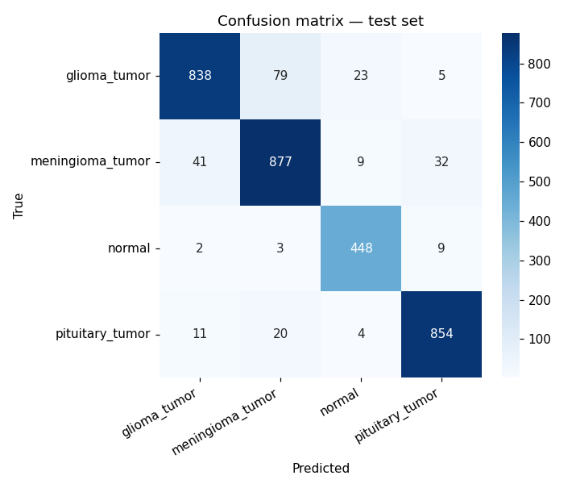
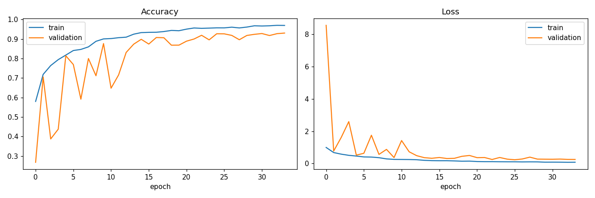
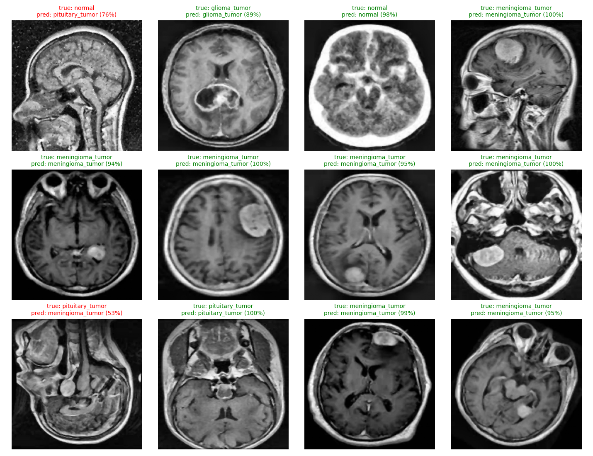
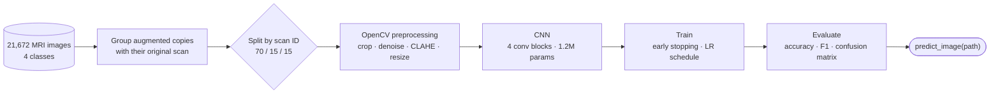
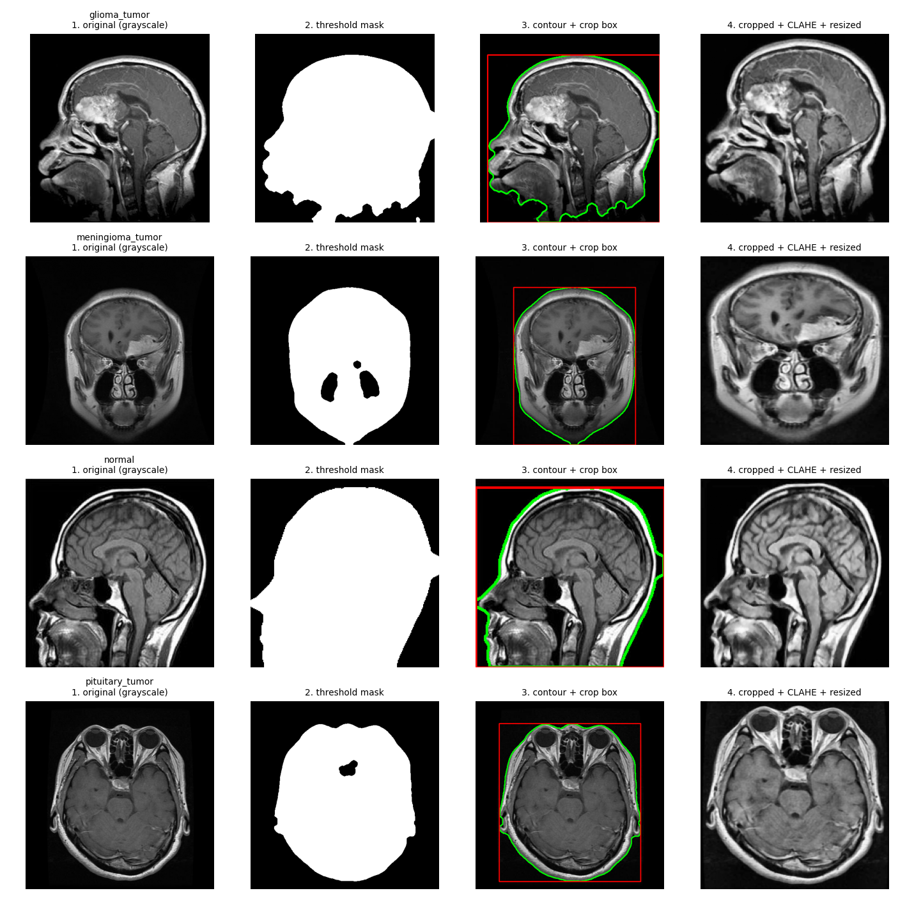
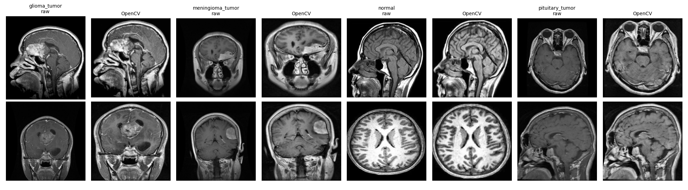
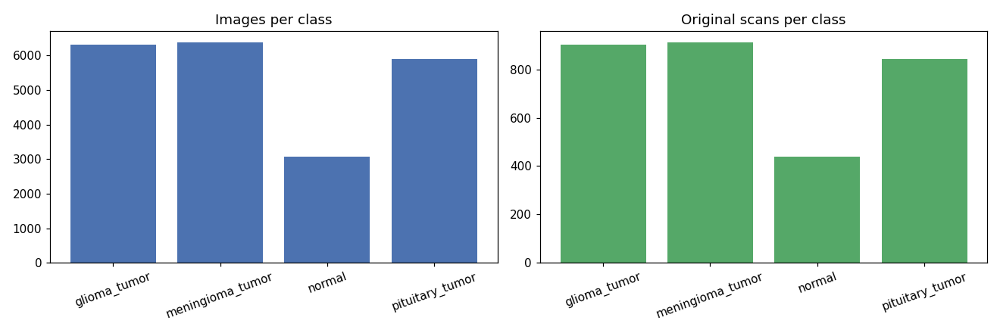

<div align="center">

# 🧠 Brain Tumor MRI Classification

### OpenCV preprocessing + a Convolutional Neural Network, built from scratch

Classifies brain MRI scans as **glioma**, **meningioma**, **pituitary tumor**, or **normal**,
with a leak-free train / validation / test split.

[](#-results)
[](#-results)
[](#-dataset)

[](https://www.python.org/)
[](https://www.tensorflow.org/)
[](https://opencv.org/)
[](https://scikit-learn.org/)
[](https://www.kaggle.com/code/vigneshwarpa/brain-tumor-mri-classification-opencv-cnn)

[](https://colab.research.google.com/github/vignxhhh/brain-tumor-mri-cnn/blob/main/brain_tumor_cnn.ipynb)
[](https://www.kaggle.com/code/vigneshwarpa/brain-tumor-mri-classification-opencv-cnn)

[Results](#-results) · [How it works](#%EF%B8%8F-how-it-works) · [OpenCV preprocessing](#-opencv-preprocessing) · [Dataset](#-dataset) · [Run it](#-run-it-yourself) · [Limitations](#%EF%B8%8F-limitations)

</div>

---

## 📊 Results

| Evaluated on | Images | Accuracy | Macro F1 |
|:--|--:|:--:|:--:|
| **Original scans only** (never seen in training in any form) | 465 | **94.0%** | **0.943** |
| All test images (originals + their augmented copies) | 3,255 | 92.7% | 0.930 |

<table>
<tr>
<td width="50%" valign="top">

**Per-class performance** (all test images)

| Class | Precision | Recall | F1 |
|:--|:--:|:--:|:--:|
| 🔴 Glioma | 0.940 | 0.887 | 0.912 |
| 🟠 Meningioma | 0.896 | 0.915 | 0.905 |
| 🟢 Normal | 0.926 | **0.970** | 0.947 |
| 🔵 Pituitary | **0.949** | 0.961 | **0.955** |

**Takeaways**
- Normal scans are recognised most reliably (97% recall).
- Most mistakes are **glioma ↔ meningioma**, two tumor types that can look alike on MRI.
- The costliest error is glioma predicted as normal: **23 of 945** glioma test images (2.4%).

</td>
<td width="50%" valign="top">



</td>
</tr>
</table>

<details>
<summary><b>📈 Training curves</b> (click to expand)</summary>
<br>



Training ran for **34 epochs** on a Kaggle T4 GPU before early stopping restored the best weights. Validation
accuracy settles around 93%, close to training accuracy, so the model is not badly overfitting. The early
spikes in validation loss are typical of BatchNorm networks in their first epochs.

</details>

<details>
<summary><b>🔍 Example predictions</b> (click to expand)</summary>
<br>



Green titles are correct predictions; red titles are wrong. Each title shows the model's confidence.

</details>

---

## ⚙️ How it works



| Stage | Details |
|:--|:--|
| **Split** | 70% train / 15% validation / 15% test, stratified by class and grouped by **original scan**: 15,169 / 3,248 / 3,255 images |
| **Preprocessing** | OpenCV pipeline (below) → 224 × 224 grayscale, pixels scaled to [0, 1] |
| **Model** | 4 blocks of (Conv 3×3 → BatchNorm → ReLU) ×2 → MaxPool → Dropout, with 32 → 64 → 128 → 256 filters, then Global Average Pooling → Dense(256) → Dropout(0.4) → Softmax(4) |
| **Training** | Adam (lr 1e-3), sparse categorical cross-entropy, balanced class weights, on-the-fly flip / rotation / zoom, EarlyStopping (patience 8), ReduceLROnPlateau, ModelCheckpoint |
| **Evaluation** | Reported on all test images **and** on original scans only |

<details>
<summary><b>🛡️ Why split by scan ID? (avoiding data leakage)</b></summary>
<br>

The dataset stores every original scan together with **6 augmented copies**: brightened (`_BR_`), darkened (`_DA_`),
horizontally flipped (`_HF_`), rotated (`_RO_`), salt-and-pepper noise (`_SP_`) and vertically flipped (`_VF_`).

If the files are split at random, a flipped copy of a test scan can end up in the training set. The model then
scores well on test images it has effectively already seen, and the reported accuracy is higher than it would be
on new patients. Many public notebooks for this dataset make this mistake.

This project gives every file a **scan ID** (`P_100_HF_.jpg` → `pituitary_tumor/P_100`) and splits the
**scan IDs**, so all 7 versions of a scan always land in the same split. An assertion in the notebook fails if any
scan appears in two splits.

</details>

<details>
<summary><b>🧱 Model architecture</b></summary>
<br>

```
Input (224, 224, 1)
├─ RandomFlip · RandomRotation(0.05) · RandomZoom(0.1)        ← training-time augmentation
├─ Block 1: [Conv2D(32)  → BN → ReLU] ×2 → MaxPool → Dropout(0.10)
├─ Block 2: [Conv2D(64)  → BN → ReLU] ×2 → MaxPool → Dropout(0.15)
├─ Block 3: [Conv2D(128) → BN → ReLU] ×2 → MaxPool → Dropout(0.20)
├─ Block 4: [Conv2D(256) → BN → ReLU] ×2 → MaxPool → Dropout(0.25)
├─ GlobalAveragePooling2D
├─ Dense(256, ReLU) → Dropout(0.40)
└─ Dense(4, Softmax)                                           → glioma | meningioma | normal | pituitary

Total parameters: 1,241,380
```

Global average pooling replaces a large Flatten + Dense layer, which keeps the parameter count small and reduces
overfitting.

</details>

---

## 🔬 OpenCV preprocessing

Raw scans have a lot of empty background and come in different sizes (mostly 224×224 and 512×512, plus a few
others). Some contain salt-and-pepper noise, and brightness varies. Every image goes through this OpenCV pipeline
before it reaches the CNN:



<details>
<summary><b>Step-by-step breakdown</b></summary>
<br>

| # | Step | OpenCV | Why |
|:-:|:--|:--|:--|
| 1 | Read as grayscale | `cv2.imread(path, cv2.IMREAD_GRAYSCALE)` | MRI is single-channel; three identical RGB channels waste memory |
| 2 | Remove noise | `cv2.medianBlur` | Removes salt-and-pepper dots while keeping edges sharp |
| 3 | Blur for masking | `cv2.GaussianBlur` | Smooths the image so the head outline comes out as one clean shape |
| 4 | Threshold | `cv2.threshold` | Pixels brighter than the background (measured from the image border) + 15 become the head mask |
| 5 | Clean the mask | `cv2.morphologyEx` (open, close) | *Open* removes specks; *close* fills gaps so the head is one solid blob |
| 6 | Find the head | `cv2.findContours` | The largest external contour is the head |
| 7 | Crop | `cv2.boundingRect` + slicing | Cuts away background so the head fills the frame |
| 8 | Boost contrast | `cv2.createCLAHE` | Local histogram equalisation makes tumor boundaries stand out |
| 9 | Resize | `cv2.resize(..., interpolation=cv2.INTER_AREA)` | Every image becomes 224×224; `INTER_AREA` is best for shrinking |

The threshold adapts to each image's own background level, so brightened scans (grey background instead of black)
are still cropped correctly. If no head outline is found, the full image is used instead of failing.

</details>

<details>
<summary><b>Raw vs. preprocessed samples</b></summary>
<br>



</details>

---

## 🗂 Dataset

[**Brain MRI images dataset**](https://www.kaggle.com/datasets/babaraliuser/brain-mri-images-dataset) by Babar Ali on Kaggle.

| Class | Images | Original scans |
|:--|--:|--:|
| Glioma tumor | 6,307 | 901 |
| Meningioma tumor | 6,391 | 913 |
| Normal | 3,066 | 438 |
| Pituitary tumor | 5,908 | 844 |
| **Total** | **21,672** | **3,096** |

The normal class is about half the size of the others; balanced class weights correct for this during training.
The images are **not** included in this repository. Download them from Kaggle.

<details>
<summary><b>Class balance chart</b></summary>
<br>



</details>

---

## 🚀 Run it yourself

<details open>
<summary><b>Option 1: Kaggle (easiest, free GPU)</b></summary>
<br>

1. Open the notebook on Kaggle with the badge at the top, or import `brain_tumor_cnn.ipynb` into a new Kaggle notebook.
2. **Add Input** → search *Brain MRI images dataset* (Babar Ali) → **+**.
3. **Settings → Accelerator → GPU T4 x2**.
4. **Run All**. The first cell finds the dataset automatically. Training takes about 1.5 hours.

</details>

<details>
<summary><b>Option 2: Google Colab</b></summary>
<br>

1. Click **Open in Colab** at the top and set **Runtime → Change runtime type → GPU**.
2. Download the dataset from Kaggle (manually, or with the [Kaggle API](https://github.com/Kaggle/kaggle-api)) and unzip it into the Colab working folder.
3. Run all cells. The setup cell searches for the `glioma_tumor` folder wherever you unzipped it.

</details>

<details>
<summary><b>Option 3: Your own machine</b></summary>
<br>

```bash
git clone https://github.com/vignxhhh/brain-tumor-mri-cnn.git
cd brain-tumor-mri-cnn
pip install -r requirements.txt

# download the dataset from Kaggle and unzip it so the class folders are under data/mri/
jupyter notebook brain_tumor_cnn.ipynb
```

A GPU is strongly recommended. On a CPU, set the environment variable `IMG_SIZE=128` to speed things up.

</details>

<details>
<summary><b>Use the trained model without retraining</b></summary>
<br>

`models/best_model.keras` (15 MB) is the trained network. To classify a new scan, run the notebook's preprocessing
and prediction cells and then:

```python
from tensorflow import keras
model = keras.models.load_model("models/best_model.keras")

label, scores = predict_image("path/to/scan.jpg", model)   # applies the same OpenCV preprocessing
print(label, scores)
```

The model expects images preprocessed exactly as in training (OpenCV crop + CLAHE, 224×224 grayscale), which
`predict_image` handles for you.

</details>

---

## 📁 Repository structure

```
brain-tumor-mri-cnn/
├── brain_tumor_cnn.ipynb   # complete workflow: data → OpenCV → CNN → evaluation → prediction
├── models/
│   └── best_model.keras    # trained model (lowest validation loss)
├── images/                 # figures used in this README
├── requirements.txt
└── README.md
```

---

## ⚠️ Limitations

- Results come from **one dataset**. Scans from other hospitals, MRI machines or imaging protocols may score lower.
- **Glioma and meningioma** are the hardest pair to separate, and some gliomas are missed as normal.
- Each prediction looks at a single 2D slice, not a full 3D MRI volume.
- This is a student learning project and is **not a medical device**. It must not be used for diagnosis.

---

<div align="center">

**Built by [Vigneshwar](https://github.com/vignxhhh)** · Computer Engineering, Arizona State University

If this project was useful or interesting, consider giving it a ⭐

</div>
